# Arcade BASIC

[](https://github.com/3583Bytes/Arcade-BASIC/actions/workflows/ci.yml)
[](https://github.com/3583Bytes/Arcade-BASIC/releases/latest)
[](https://dotnet.microsoft.com/)
[](https://www.iso.org/standard/18305.html)
[](LICENSE)

**Full BASIC** — the ISO/ANSI standard, with its graphics module — for making small games and
programs, in an IDE that runs in your browser. Write it, run it, debug it, and share a link that
opens straight into your game.

### [▶ Open the IDE](https://3583bytes.github.io/Arcade-BASIC/) — nothing to install

<a href="https://3583bytes.github.io/Arcade-BASIC/">
  <picture>
    <source media="(prefers-color-scheme: light)" srcset="docs/images/ide-light.png">
    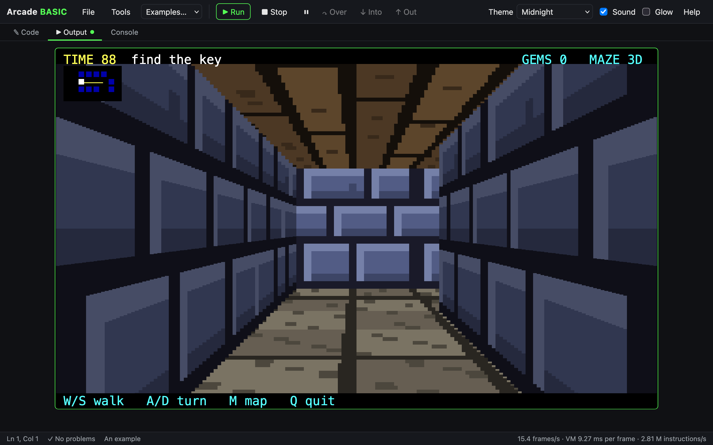
  </picture>
</a>

- **An IDE in the browser:** an editor that checks your program as you type, a debugger, a pixel
  editor for sprites and textures, a tune editor for `PLAY`, sound, and six themes.
- **A standard language:** ISO/IEC 10279 Full BASIC — `SUB`s and `FUNCTION`s, modules, `SELECT CASE`,
  exceptions, matrices, exact decimal arithmetic — with the ANSI graphics module and a few Microsoft
  BASIC favourites (`INKEY$`, `SOUND`, `PLAY`) for games.
- **Share and ship:** a link that opens your program to edit or to play, a single native
  executable, or a desktop app.

## Play

Every picture opens its game in the IDE, ready to play (*code* opens its program in the editor).
They're all in [`examples/`](examples/), written in Arcade BASIC.

<table>
  <tr>
    <td align="center" width="33%">
      <a href="https://3583bytes.github.io/Arcade-BASIC/#play/maze3d">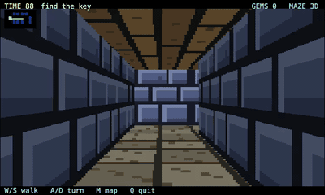</a><br>
      <b>Maze 3D</b> · <a href="https://3583bytes.github.io/Arcade-BASIC/#maze3d">code</a>
    </td>
    <td align="center" width="33%">
      <a href="https://3583bytes.github.io/Arcade-BASIC/#play/invaders">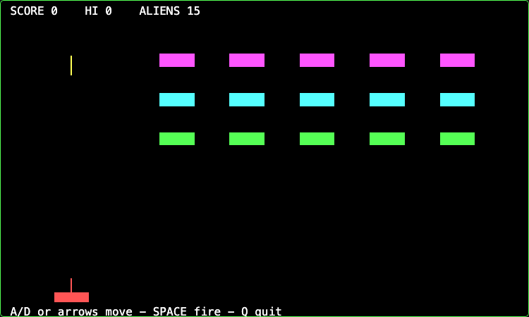</a><br>
      <b>Invaders</b> · <a href="https://3583bytes.github.io/Arcade-BASIC/#invaders">code</a>
    </td>
    <td align="center" width="33%">
      <a href="https://3583bytes.github.io/Arcade-BASIC/#play/breakout">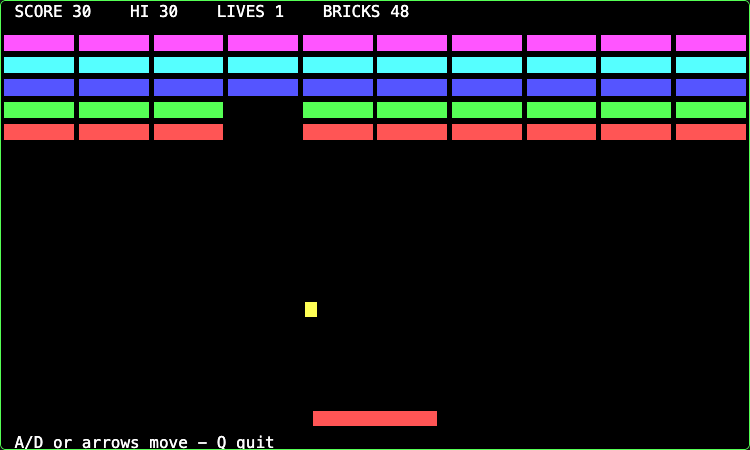</a><br>
      <b>Breakout</b> · <a href="https://3583bytes.github.io/Arcade-BASIC/#breakout">code</a>
    </td>
  </tr>
  <tr>
    <td align="center">
      <a href="https://3583bytes.github.io/Arcade-BASIC/#play/tetris">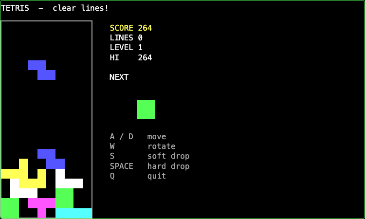</a><br>
      <b>Tetris</b> · <a href="https://3583bytes.github.io/Arcade-BASIC/#tetris">code</a>
    </td>
    <td align="center">
      <a href="https://3583bytes.github.io/Arcade-BASIC/#play/kanban">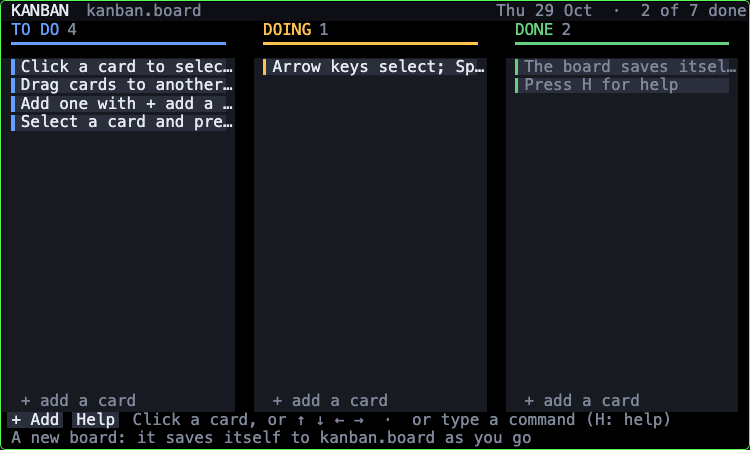</a><br>
      <b>Kanban</b> · <a href="https://3583bytes.github.io/Arcade-BASIC/#kanban">code</a>
    </td>
    <td align="center">
      <a href="https://3583bytes.github.io/Arcade-BASIC/#play/readyedit">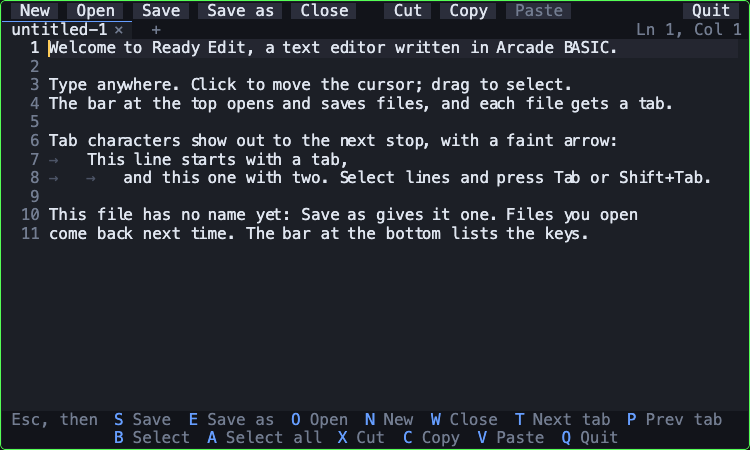</a><br>
      <b>Ready Edit</b> · <a href="https://3583bytes.github.io/Arcade-BASIC/#readyedit">code</a>
    </td>
  </tr>
</table>

Also there: Snake, Super Star Trek (1978), Lunar Lander (1969), a Mandelbrot set, a music demo and
more — see [`examples/README.md`](examples/README.md).

## The IDE

Pick an example or start a new program, press **Run** (F5), and click the screen so it gets your
keys. Your programs stay in the browser between visits, and you can open and save `.bas` files of
your own. Nothing is sent anywhere.

<table>
  <tr>
    <td width="50%">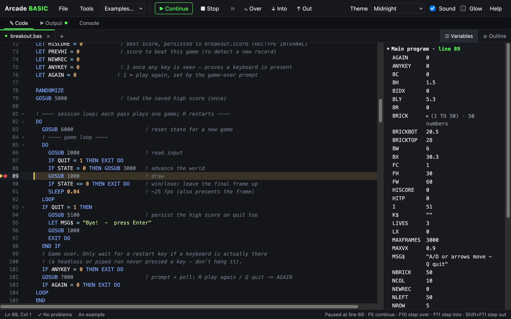</td>
    <td width="50%">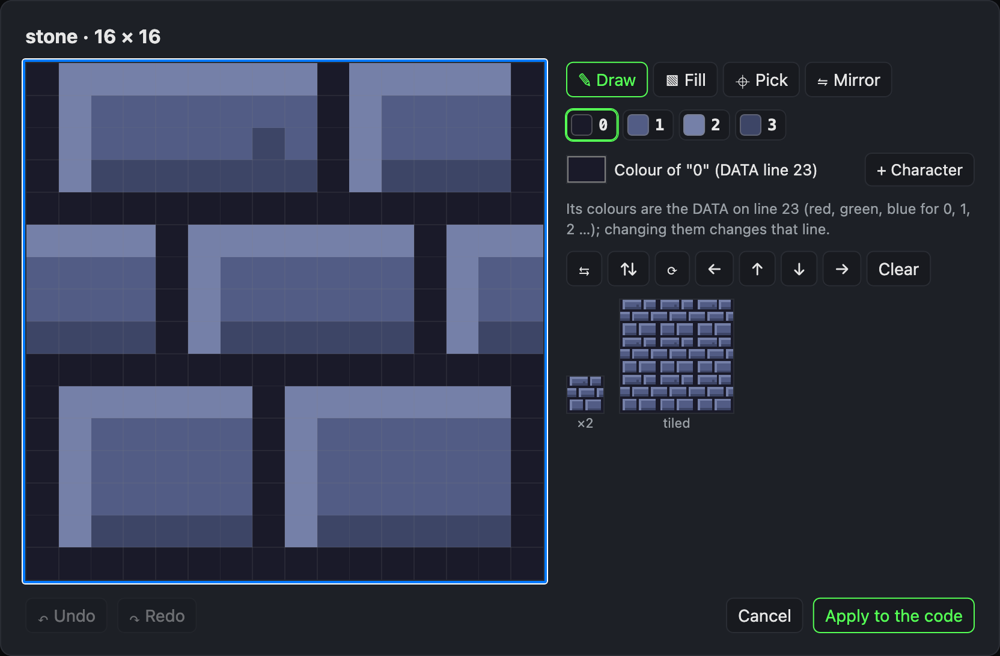</td>
  </tr>
  <tr>
    <td><b>A debugger</b>: breakpoints, stepping over, into and out, and every variable as it changes.</td>
    <td><b>A pixel editor</b> for the sprites and textures a program keeps in <code>DATA</code> lines.</td>
  </tr>
  <tr>
    <td>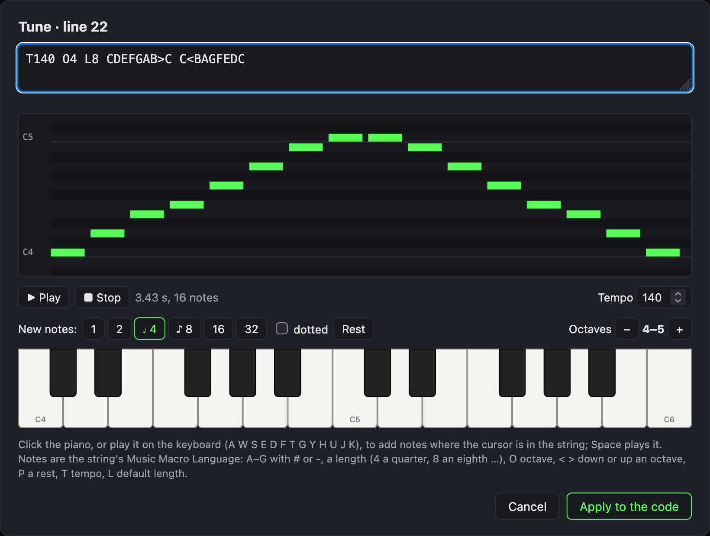</td>
    <td>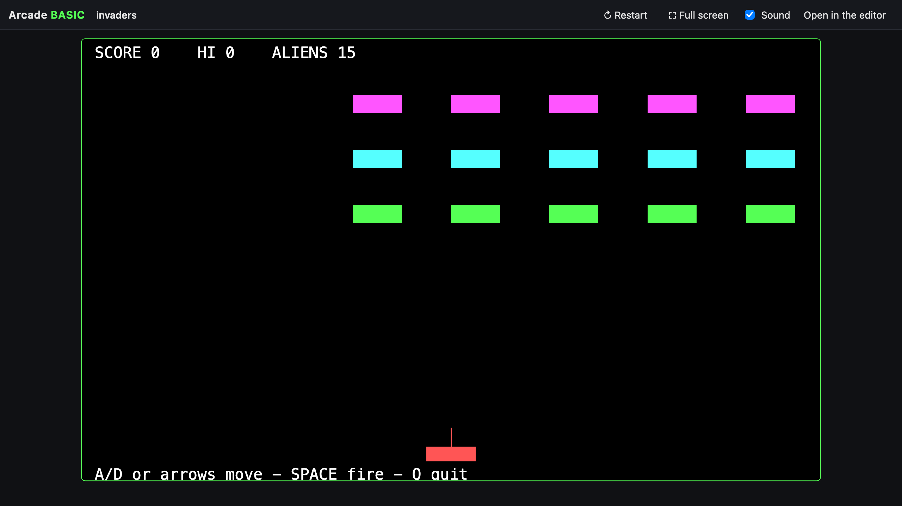</td>
  </tr>
  <tr>
    <td><b>A tune editor</b> for <code>PLAY</code> strings: a piano roll, and a keyboard to play notes in.</td>
    <td><b>Play links</b>: <i>File → Copy a link to play this program</i> opens straight into it, no editor.</td>
  </tr>
  <tr>
    <td>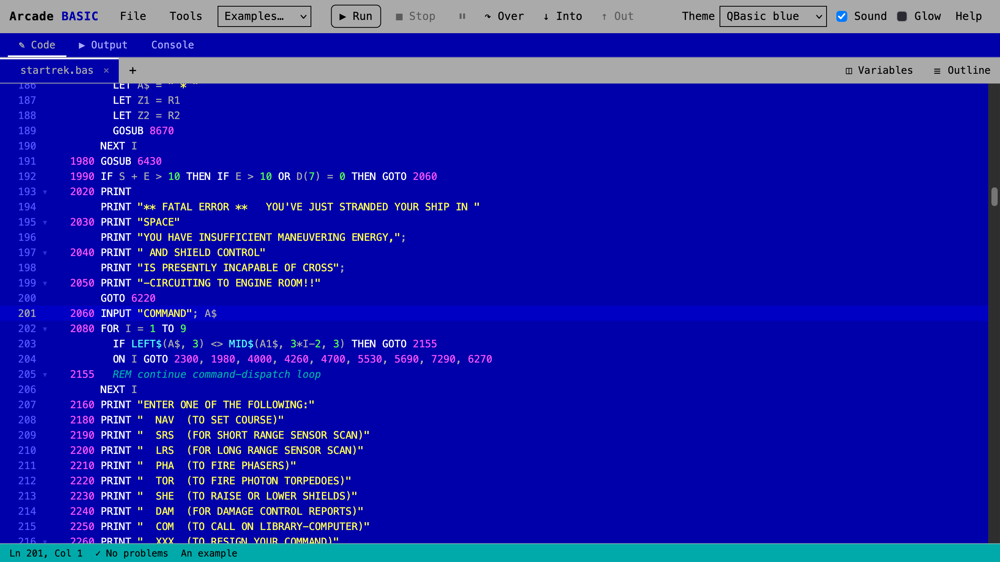</td>
    <td>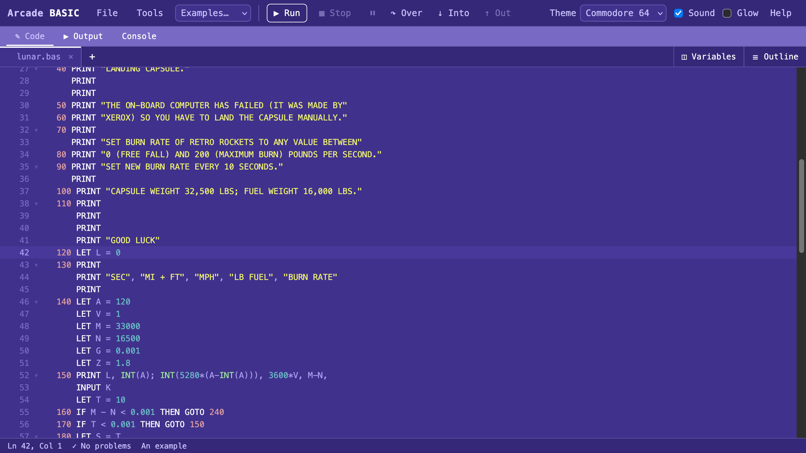</td>
  </tr>
  <tr>
    <td><b>Six themes</b>, QBasic blue among them…</td>
    <td>…and Commodore 64.</td>
  </tr>
</table>

Also: problems underlined as you type, completion, go to definition, an outline and folding for
long programs, programs in several files (`LIBRARY`), colour swatches and a palette, sound, and
the files your programs write kept in the browser. The IDE's own guide is
[`src/ArcadeBasic.Web/README.md`](src/ArcadeBasic.Web/README.md).

## The language

Arcade BASIC is ISO/IEC 10279 **Full BASIC** (ANSI X3.113-1987, ECMA-116): the structured BASIC of
the 1980s standards — no line numbers needed — with the standard's graphics module. A ball that
bounces round the screen:

```basic
! A ball that bounces off the edges. Press Q to stop.
SET WINDOW 0, 160, 0, 100            ! your own coordinates: 160 across, 100 up
LET X = 20
LET Y = 70
LET DX = 1.5
LET DY = -1
DO
  CLEAR
  CALL BALL(X, Y)
  IF X + DX < 3 OR X + DX > 157 THEN LET DX = -DX
  IF Y + DY < 3 OR Y + DY > 97 THEN LET DY = -DY
  LET X = X + DX
  LET Y = Y + DY
  SLEEP 0.02                         ! one frame
LOOP UNTIL INKEY$ = "q"

SUB BALL(X, Y)
  SET AREA COLOR 3
  GRAPH AREA: X - 3, Y - 3; X + 3, Y - 3; X + 3, Y + 3; X - 3, Y + 3
END SUB
END
```

**[▶ Run this in your browser](https://3583bytes.github.io/Arcade-BASIC/#code=dVDRboJAEHy_rxhNH9oIBDTW1FYTlGslvQAFjPCIetYmlrMcxvTvm-PU2KTdl9mZ3dnduxZcLIvdDvW2qLEUh3LFJcRmg3rLwdfvXFqIKi4l3lALyFrsLZLQFAs_8MIFbAPOvW00aNu4iha-xaGCOJZYCVGtP8qi5nKo2lGsKiGlthz2hNEUGUbo2k2aY4SBTj0lO1ZfE1UwHeKFBJgy6sYKXcYwcRm7zQzkdwTwn5Gho6xP6CGMz2wMpz9AOqMBLqNNL9OOXPXkZ8eJjfFwbWjWezkBzgfrySdBlbWRAAmjNIJt2V38Fy2IkmNTFZ-csDCMMA9Sn8EPXml-gxHaX21Ckvnk9-vU37sxdTENWRijR4CX2I1mjThEBhM9A7mCx-a-P1hHM_PCCA08JPOJQvID)**

What's in it:

- **Structured programs:** `SUB`, `FUNCTION` and `DEF`, `MODULE`s with `PUBLIC` and `SHARE`
  variables, programs in several files (`LIBRARY`), `SELECT CASE`, `DO … LOOP`, `EXIT`; `GOTO`,
  `GOSUB` and line numbers still work, so 1970s listings run too.
- **Numbers that add up:** exact decimal arithmetic (`0.1 + 0.2` is `0.3`), or
  `OPTION ARITHMETIC NATIVE` for hardware speed; matrices with `MAT` (`+`, `*`, `TRN`, `INV`, …).
- **Exceptions:** `WHEN … USE`, `CAUSE EXCEPTION`, `RETRY`, `CONTINUE`, named handlers.
- **Text and files:** `PRINT USING` pictures, `INPUT`, `READ`/`DATA`, files on channels
  (`OPEN #1: NAME "scores.txt"`), exact-value `INTERNAL` records.
- **Graphics:** the standard's `SET WINDOW`, `GRAPH LINES`/`AREA`/`TEXT` with clipping, and
  `MAT GRAPH CELLS` and `SET COLOR MIX` for pixels and a 256-colour palette; the mouse with
  `GET MOUSE` and `LOCATE POINT`.
- **For games:** `INKEY$` and `KEYDOWN` (held keys), `SLEEP` to pace a frame, and `SOUND`, `BEEP`
  and `PLAY` (Music Macro Language) — Microsoft BASIC's, marked as such in the docs.

The **[language reference](docs/keywords.md)** has every keyword and function with an example;
**[conformance](docs/conformance.md)** lists where Arcade BASIC departs from the standard and what
it adds.

## Outside the browser

The same engine — compiled to bytecode, run on a VM — runs everywhere:

| | Command | |
|---|---|---|
| **Command line** | `arcade-basic run foo.bas` | Runs a program in a terminal; its graphics are drawn with Braille and ANSI colours, its sound played. `--svg out.svg` and `--wav out.wav` save them instead. |
| **Native binary** | `arcade-basic build foo.bas -o foo` | One self-contained executable for Linux, macOS or Windows; no .NET needed where it runs. |
| **Desktop app** | `arcade-basic build foo.bas --desktop` | Your program in a window of its own, as in the browser (a Mac `.app`, or a Windows or Linux executable). Needs the desktop player ([`desktop/player`](desktop/player)). |
| **REPL** | `arcade-basic repl` | Type a line, see it run; blocks (`FOR`, `SUB`, …) continue on the next line. |
| **.NET** | `BasicEngine.Run(source, out output)` | Embed it: the libraries target `net10.0` and `netstandard2.1`. |

`arcade-basic` for Linux, macOS (Intel and Apple Silicon) and Windows is attached to each
[release](https://github.com/3583Bytes/Arcade-BASIC/releases/latest).

```sh
$ arcade-basic run examples/hello.bas
$ arcade-basic build examples/invaders.bas -o invaders && ./invaders
```

```csharp
using ArcadeBasic;

BasicEngine.Run("PRINT 6 * 7", out var output);
Console.WriteLine(output);   //  42
```

## Documentation

- [**Language reference**](docs/keywords.md) — every keyword and function, with examples. Start here to learn the language.
- [**Conformance**](docs/conformance.md) — where Arcade BASIC follows ISO 10279, where it departs, and its extensions.
- [**Examples**](examples/README.md) — the sample programs and what each one shows.
- [**The IDE**](src/ArcadeBasic.Web/README.md) — what the browser IDE does, and how to build and serve it yourself.
- [**Building from source**](docs/building.md) — prerequisites, and publishing the CLI and standalone binaries per platform.
- [**Standalone builds**](docs/standalone-builds.md) — how `arcade-basic build` turns a `.bas` into one executable, or a desktop app.
- [**Architecture**](docs/architecture.md) — the pipeline, project graph and key data structures.
- [**Contributing**](CONTRIBUTING.md) — the build and test loop, and recipes for adding functions, statements and opcodes.
- [**Changelog**](CHANGELOG.md) — what each release changed.

## Build from source

Requires the .NET 10 SDK.

```sh
git clone https://github.com/3583Bytes/Arcade-BASIC.git arcade-basic
cd arcade-basic

dotnet build                                                    # debug build
dotnet test                                                     # all tests (about 800)
dotnet run --project src/ArcadeBasic.Cli -- run examples/hello.bas
dotnet run --project src/ArcadeBasic.Web -c Release             # the IDE, on localhost

# An AOT-compiled standalone CLI for this platform
dotnet publish src/ArcadeBasic.Cli -c Release -r osx-arm64 -o publish/cli
```

The pictures in this README come from the IDE itself: `node tools/screenshots/shots.mjs` takes
them all again (it needs Node 22 or later and Firefox).

## CLI reference

```
arcade-basic <command> [args]

  run <file>              compile to bytecode and run it on the VM (vm is the same)
  build <file> [-o out]   produce a self-contained native binary
    --desktop             ... or a desktop app: the program in a window (--player <arcade-player>)
  repl                    interactive Arcade BASIC session
  lex <file>              tokenize and print the token stream
  parse <file>            lex + parse, pretty-print the AST
  analyze <file>          lex + parse + sema, print symbol/DATA summary
  --version
```

## How it's built

A compiler pipeline and a bytecode VM in one C# solution. Each box is its own assembly, so you can
pull in only what you need:

```
   Source file
        │
        ▼
  Lexer ──► Parser ──► Sema ──► Compiler ──► Bytecode VM ──► output
                                                  │
                                                  ├──► the browser IDE (WebAssembly)
                                                  └──► self-extracting native binary
```

| Project | Purpose |
|---|---|
| `ArcadeBasic.Core` | source files, positions, diagnostics |
| `ArcadeBasic.Lexer` | tokenizer |
| `ArcadeBasic.Parser` | recursive-descent parser → immutable AST |
| `ArcadeBasic.Sema` | two-pass analyzer; symbol/scope resolution as a side table |
| `ArcadeBasic.Runtime` | `BigDecimal`-backed values, builtins, picture-string formatter, channels |
| `ArcadeBasic.Bytecode` | opcode enum, chunk format, serializer |
| `ArcadeBasic.Compiler` | AST → bytecode lowering |
| `ArcadeBasic.Vm` | stack-based bytecode VM, and `BasicEngine` (source in, program run) |
| `ArcadeBasic.Cli` | command dispatcher + self-extracting AOT stub |
| `ArcadeBasic.Web` | the browser IDE (WebAssembly, on the VM) |
| `ArcadeBasic.Player` | the player for desktop apps: a compiled program on the VM, no IDE (WebAssembly) |
| `desktop/player` | the desktop player: the player page in a native window (Tauri) |

The full write-up is [`docs/architecture.md`](docs/architecture.md).

## Why?

Because why not. For fun, mostly.

## License

[MIT](LICENSE) © 2026 Adam.
