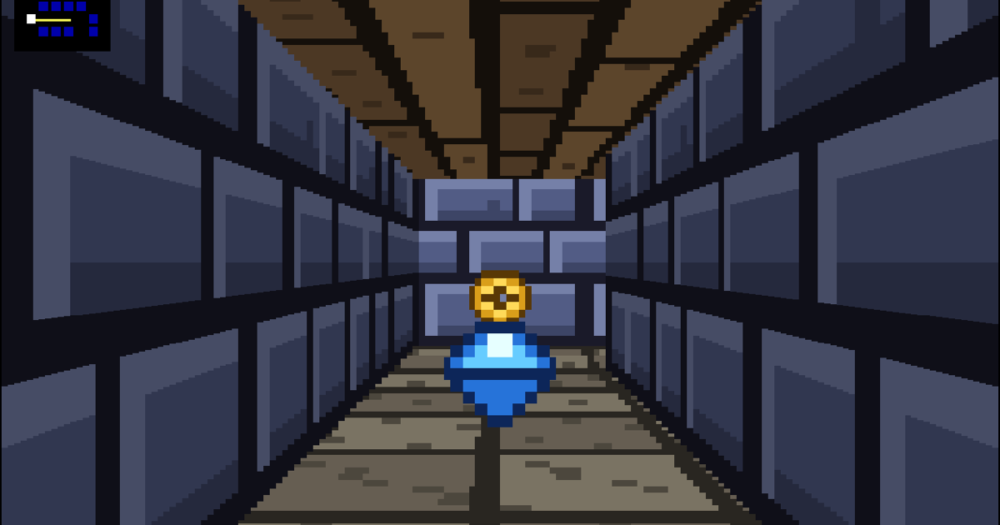

# Arcade BASIC

[](https://github.com/3583Bytes/Arcade-BASIC/actions/workflows/ci.yml)
[](https://github.com/3583Bytes/Arcade-BASIC/releases/latest)
[](https://dotnet.microsoft.com/)
[](https://www.iso.org/standard/18305.html)
[](LICENSE)

A fun and modern re-implementation of **Full BASIC** including an interpreter, compiler, and IDE Based on (ISO/IEC 10279:1991, ANSI X3.113-1987) and ECMA-116 for Graphics module implementation.

Run classic BASIC programs, write new ones, embed BASIC in your .NET app, or ship a `.bas` file as a self-contained native binary.  Learn to code, or not.

**[▶ Write and run BASIC in your browser](https://3583bytes.github.io/Arcade-BASIC/)** — nothing to install: an editor that checks your program as you type, programs in several files (`LIBRARY`), an outline and folding for long ones, a debugger (breakpoints, stepping, the variables as they change), a pixel editor for the sprites and textures kept in `DATA`, colour swatches and a palette, a tune editor for `PLAY`, open and save your own `.bas` files, share a link that opens straight into your game, six themes (QBasic blue and Commodore 64 among them), sound, and the example programs to play and change: a textured 3D maze, Breakout, Invaders, Tetris, a kanban board…

[](https://3583bytes.github.io/Arcade-BASIC/)

## Why? 

Because Why Not.  For fun mostly.  

## In one minute

A tiny BASIC program:

```basic
PRINT "Hello, Arcade BASIC!"
FOR I = 1 TO 3
  PRINT "  squared:"; I; "->"; I * I
NEXT I
```

Run it on the interpreter:

```sh
$ arcade-basic run hello.bas
Hello, Arcade BASIC!
  squared: 1 -> 1
  squared: 2 -> 4
  squared: 3 -> 9
```

Same program, compiled to a self-contained native binary that runs anywhere — no .NET install required:

```sh
$ arcade-basic build hello.bas -o hello
$ ./hello
Hello, Arcade BASIC!
  squared: 1 -> 1 ...
```

Or embed it in your C# app:

```csharp
using ArcadeBasic;

BasicEngine.Run("PRINT 6 * 7", out var output);
Console.WriteLine(output);   //  42
```

## What you can do with it

- **Run vintage BASIC games.** The repo ships [`startrek.bas`](examples/startrek.bas) (Super Star Trek, Dave Ahl 1978) and [`lunar.bas`](examples/lunar.bas) (Storer's 1969 Lunar Lander), faithfully ported to Full BASIC.
- **Write real-time games.** `INKEY$` (non-blocking keyboard), `KEYDOWN` (held keys) and `SLEEP` (frame delay) drive a game loop, and `OPTION ARITHMETIC NATIVE` swaps exact decimal arithmetic for hardware doubles — 2–8× faster on math-heavy code; combined with the graphics module that's a playable [`invaders.bas`](examples/invaders.bas) (Space Invaders) in the browser, in a terminal with the CLI, or as a standalone binary. (These are Microsoft-BASIC and Arcade BASIC extensions, flagged as such in the docs.)
- **Draw with the graphics module.** ECMA-116 §13 `SET WINDOW`/`GRAPH LINES`/`AREA`/`POINTS`/`TEXT` with windowing and clipping. Render to SVG (`arcade-basic run examples/graphics.bas --svg out.svg`), live in **any terminal** (the CLI and standalone binaries draw with a Braille + ANSI backend), or on the canvas in the browser IDE.
- **Make sound.** `SOUND`, `BEEP`, and `PLAY` (Music Macro Language) — the GW-BASIC/QuickBASIC audio verbs, flagged as Microsoft-dialect extensions in the docs. Plays in **real time** on an interactive terminal (Windows/macOS/Linux), and in the browser, and renders to a WAV file with `arcade-basic run examples/music.bas --wav out.wav`. Foreground (`MF`) and background (`MB`) music both work. See [docs/audio-extension.md](docs/audio-extension.md).
- **Ship a `.bas` file as a one-file native binary.** `arcade-basic build foo.bas -o foo` produces a single executable for Linux, macOS (Intel + Apple Silicon), or Windows. No interpreter to install, no runtime dependency.
- **Embed BASIC in a .NET game or app.** The libraries multi-target `netstandard2.1`, so they drop into .NET Framework, Xamarin, or any modern .NET host. Ideal for in-game scripting, modding hooks, or programmable retro consoles.
- **Learn how a language gets implemented.** Clean separation of lexer → parser → semantic analyzer → compiler → bytecode VM, all in one C# solution with extensive tests.

## Ways to run a program

| | Command | Best for |
|---|---|---|
| **Browser** | [the IDE](https://3583bytes.github.io/Arcade-BASIC/) | Writing, debugging and playing — graphics, sound, mouse. |
| **Command line** | `arcade-basic run foo.bas` | Compiles to bytecode and runs it on the VM, in a terminal. |
| **Native binary** | `arcade-basic build foo.bas -o foo` | Bundles the VM and your compiled program into a single self-contained executable — no .NET needed on the target. |
| **Desktop app** | `arcade-basic build foo.bas --desktop` | Your compiled program in a window of its own — its screen, sound and keys as in the browser, no IDE (a Mac `.app`, or a Windows or Linux executable). Needs the desktop player, `arcade-player` ([`desktop/player`](desktop/player)). |

All of them run the same engine, the bytecode VM, so they execute the same surface of the language: arrays, MAT operations (transpose, inverse, multiply, …), file I/O, `INPUT`/`LINE INPUT`, `READ`/`DATA`/`RESTORE`, `PRINT USING` with picture strings, modules (`PUBLIC` and `SHARE` variables, `DECLARE PUBLIC`, start-up code, their own `DATA`) and programs in several files (`LIBRARY "file.bas"`), exception handling (`WHEN`/`USE`/`CAUSE`/`RETRY`/`CONTINUE`), and named handlers.

## Try the IDE

The IDE runs in the browser — **[open it](https://3583bytes.github.io/Arcade-BASIC/)**, nothing to install. To build and run it yourself, see [`src/ArcadeBasic.Web/README.md`](src/ArcadeBasic.Web/README.md).

## Try the REPL

```sh
arcade-basic repl
```

```
Arcade BASIC REPL — type .help for commands, .exit to quit.
> LET X = 42
> PRINT X * 2
 84
> FOR I = 1 TO 4
...   PRINT I, I * I
... NEXT I
 1               1
 2               4
 3               9
 4               16
> PRINT SIN(PI / 2)
 1
> .exit
bye.
```

Each accepted line is appended to a growing session source. Multi-line blocks (`FOR`, `DO`, `IF`, `SELECT`, `SUB`, `FUNCTION`, `DEF`, `MODULE`, `WHEN`) auto-detect and the prompt switches to `... ` until the block closes. Bad input doesn't pollute the session. `.list` shows the accumulated source; `.clear` resets it.

`INPUT` and `RANDOMIZE` don't round-trip cleanly through the REPL's re-execute-each-turn model — for those, save your code to a `.bas` file and use `arcade-basic run`.

## Example programs

23 sample programs (and two libraries they use) in [`examples/`](examples/) — from `hello.bas` and `pi.bas` (Leibniz series) up to a complete Super Star Trek port, a Lunar Lander physics sim, a graphics Kanban board, an escape-time Mandelbrot, real-time Space Invaders, Snake, Breakout, and Tetris, a first-person 3D maze, and a `PLAY`/`SOUND` music demo. Highlights:

| Program | What it shows |
|---|---|
| [`hello.bas`](examples/hello.bas) | `PRINT`, `IF`/`THEN`/`ELSE`, `FOR`, `^` |
| [`matrix.bas`](examples/matrix.bas) | `MAT` operations — `+`, `*`, `TRN`, `INV`, `IDN`, `MAT PRINT` |
| [`mandelbrot.bas`](examples/mandelbrot.bas) | escape-time Mandelbrot as ASCII art — a pure-compute benchmark (`z = z*z + c`) |
| [`exception.bas`](examples/exception.bas) | `WHEN`/`USE`/`END WHEN`, `CAUSE`, `EXLINE`, `EXTYPE`, `RETRY` |
| [`modules.bas`](examples/modules.bas) | `MODULE` blocks, `PUBLIC` vs private declarations |
| [`fileio.bas`](examples/fileio.bas) | `OPEN` / `PRINT #` / `LINE INPUT #` / `CLOSE` |
| [`formatted.bas`](examples/formatted.bas) | `PRINT USING` with picture strings |
| [`graphics.bas`](examples/graphics.bas) | §13 graphics — `SET WINDOW`, `GRAPH LINES`/`AREA`/`POINTS`/`TEXT` (render with `--svg`) |
| [`kanban.bas`](examples/kanban.bas) | a Kanban board for your own tasks that saves itself as you go — drag cards between lanes and up and down with the mouse (`GET MOUSE`), edit them, move them with the keys |
| [`invaders.bas`](examples/invaders.bas) | real-time Space Invaders — `KEYDOWN` (held keys) + `INKEY$` (key presses) + `SLEEP` (frame delay) + §13 graphics |
| [`snake.bas`](examples/snake.bas) | real-time Snake — `INKEY$` + `SLEEP` + §13 graphics; growing body, `RND` food, high score |
| [`breakout.bas`](examples/breakout.bas) | real-time Breakout — `KEYDOWN` + `INKEY$` + `SLEEP` + §13 graphics; ball physics, paddle-angle steering, lives, high score |
| [`tetris.bas`](examples/tetris.bas) | real-time Tetris — `INKEY$` + `SLEEP` + §13 graphics; `READ`/`DATA` piece table, `(r,c)->(c,-r)` rotation, line clears, levels, high score |
| [`maze3d.bas`](examples/maze3d.bas) | (three files: the game, and its level and textures as modules in [`maze3d-level.bas`](examples/maze3d-level.bas) and [`maze3d-textures.bas`](examples/maze3d-textures.bas), brought in with `LIBRARY`) first-person 3D maze, Wolfenstein-style — ray casting with textured walls, floor and ceiling and sprites — a key to find and gems to collect (`MAT GRAPH CELLS` stretches a texture column over each screen column, draws the floor and ceiling a dot at a time, and its see-through cells make sprites; `SET COLOR MIX` colours), `KEYDOWN` walking and turning |
| [`music.bas`](examples/music.bas) | audio — `SOUND`, `BEEP`, and `PLAY` (MML); render to WAV with `--wav` |
| [`startrek.bas`](examples/startrek.bas) | Super Star Trek (Dave Ahl, 1978) |
| [`lunar.bas`](examples/lunar.bas) | Lunar Lander (Jim Storer, 1969) |

See [`examples/README.md`](examples/README.md) for the full list.

## Embedding in .NET

The library projects (lexer through VM) multi-target **`net10.0`** *and* **`netstandard2.1`**, so they drop into anything from a modern ASP.NET host to a .NET Framework app. The smallest possible embed:

```csharp
using ArcadeBasic;

var result = BasicEngine.Run("LET X = 6 * 7 \n PRINT X", out string output);
Console.WriteLine(output);  //  42
```

## Quick build from source

Requires the .NET 10 SDK.

```sh
git clone https://github.com/3583Bytes/Arcade-BASIC.git arcade-basic
cd arcade-basic

dotnet build                                                    # debug build
dotnet test                                                     # all tests (about 800)
dotnet run --project src/ArcadeBasic.Cli -- run examples/hello.bas

# Produce an AOT-compiled standalone CLI for the current platform
# (PublishAot is set in the CLI csproj, so no need to pass it on the cmdline)
dotnet publish src/ArcadeBasic.Cli -c Release -r osx-arm64
# → src/ArcadeBasic.Cli/bin/Release/net10.0/<rid>/publish/arcade-basic
```

Pre-built binaries for Linux, macOS (Intel + Apple Silicon), and Windows are attached to each tagged GitHub release: `arcade-basic`, the CLI. No .NET install needed on the target machine.

## CLI reference

```
arcade-basic <command> [args]

  run <file>              compile to bytecode and run it on the VM (vm is the same)
  build <file> [-o out]   produce a self-contained native binary
    --desktop             ... or a desktop app: the program in a window (--player <arcade-player>)
  repl                    interactive Arcade BASIC session
  lex <file>              tokenize and print the token stream
  parse <file>            lex + parse, pretty-print the AST
  analyze <file>          lex + parse + sema, print symbol/DATA summary
  --version
```

Inspect intermediate stages of a program:

```sh
arcade-basic lex     examples/factorial.bas
arcade-basic parse   examples/factorial.bas
arcade-basic analyze examples/factorial.bas
```

## Documentation

- [**Keywords**](docs/keywords.md) — every reserved word with a description and a commented example. Start here if you're learning the language.
- [**Building from source**](docs/building.md) — per-platform prerequisites, RIDs, and publish commands for the CLI and standalone binaries.
- [**Architecture**](docs/architecture.md) — the pipeline, project graph, key data structures, target-framework strategy.
- [**Standalone builds**](docs/standalone-builds.md) — how `arcade-basic build` turns a `.bas` into a single self-contained executable (it's a self-extracting bytecode VM, not a native-codegen pipeline; this doc explains the anatomy of the resulting binary and why the design was chosen).
- [**Contributing**](CONTRIBUTING.md) — build/test loop and concrete recipes for adding builtins, statements, opcodes.
- [**Conformance**](docs/conformance.md) — known deviations from ISO 10279:1991 and implementation-defined choices.
- [**Examples**](examples/README.md) — the sample programs and what each one shows.

## How it's built

A clean compiler-pipeline-plus-VM in one C# solution. Each box is its own assembly so you can pull in only what you need:

```
   Source file
        │
        ▼
  Lexer ──► Parser ──► Sema ──► Compiler ──► Bytecode VM ──► output
                                                  │
                                                  ├──► the browser IDE (WebAssembly)
                                                  └──► self-extracting native binary
```

| Project | Purpose |
|---|---|
| `ArcadeBasic.Core` | source files, positions, diagnostics |
| `ArcadeBasic.Lexer` | tokenizer |
| `ArcadeBasic.Parser` | recursive-descent parser → immutable AST |
| `ArcadeBasic.Sema` | two-pass analyzer; symbol/scope resolution as a side table |
| `ArcadeBasic.Runtime` | `BigDecimal`-backed values, builtins, picture-string formatter, channels |
| `ArcadeBasic.Bytecode` | opcode enum, chunk format, serializer |
| `ArcadeBasic.Compiler` | AST → bytecode lowering |
| `ArcadeBasic.Vm` | stack-based bytecode VM, and `BasicEngine` (source in, program run) |
| `ArcadeBasic.Cli` | command dispatcher + self-extracting AOT stub |
| `ArcadeBasic.Web` | the browser IDE (WebAssembly, on the VM) |
| `ArcadeBasic.Player` | the player for desktop apps: a compiled program on the VM, no IDE (WebAssembly) |
| `desktop/player` | the desktop player: the player page in a native window (Tauri) |

The VM runs on the runtime's `Value` hierarchy, `BigDecimal` numerics, `MatOps` math kernels (LU-decomposition inverse, transpose, …), picture-string formatter, and channel table. (Until 2026 a tree-walking interpreter ran programs too, as a second, reference engine.) The full architecture writeup lives in [`docs/architecture.md`](docs/architecture.md).

## License

[MIT](LICENSE) © 2026 Adam.
